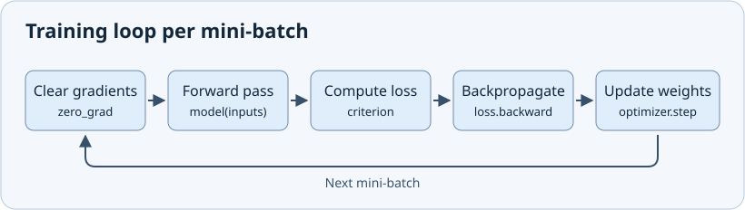

# 2. MLP และวงจรการเรียนรู้

[← ก่อนหน้า](01-introduction-pytorch.md) | [Index](../INDEX.md) | [ถัดไป →](03-mlp-problems-visualization.md)

## แหล่งเรียน

class02 · ตรวจต้นฉบับ 2026-11-14

- [class02/2_MLP1_basic_2handout_color.pdf](https://drive.google.com/file/d/1kzEV_Z8evNBVnJtRvSZzqDtpH_qE_TuK/view)
- Lab [MLP1](../labs/MLP1.md)

## เป้าหมายและพื้นฐาน

เมื่ออ่านจบควรไล่ Forward Pass จาก input ไปถึง logits เลือก output และ Loss ตามชนิดโจทย์ และอธิบายว่า Backpropagation กับ Optimizer ทำงานต่อกันอย่างไร ใช้ความหมายของ Tensor จาก [Class 01](01-introduction-pytorch.md) และใช้ [MLP1](../labs/MLP1.md) เป็นตัวอย่างตั้งแต่เตรียมข้อมูลจนถึง Inference

## Neuron และ Forward Pass

MLP จัดการคำนวณเป็น Input, Hidden และ Output Layers ขอบเชื่อมในรูปแทน Weight ส่วน Bias เลื่อนค่าที่เข้าสู่ Activation Function ของแต่ละ Neuron สำหรับ Input สองค่ากับ Hidden Layer สามหน่วยในภาพ ค่าที่หนึ่งคำนวณจาก $h_1=f(w_1x_1+w_2x_2+b_1)$ อีกสองค่าคำนวณด้วย Weight และ Bias ของหน่วยตัวเอง จากนั้น Output ใช้ $g(w_7h_1+w_8h_2+w_9h_3+b_4)$

ในรูปแบบเวกเตอร์ $\mathbf z=W\mathbf x+\mathbf b$ ถ้า $\mathbf x$ มี $d$ features และ Layer มี $m$ units แล้ว $W$ มี $m$ แถวและ $d$ คอลัมน์ ส่วน $\mathbf b$ กับ $\mathbf z$ มี $m$ ค่า เมื่อมี $B$ ตัวอย่าง PyTorch เก็บ input เป็น $(B,d)$ และได้ output $(B,m)$ โดยใช้พารามิเตอร์ชุดเดียวกับทุกตัวอย่าง

**Illustrative Example (ผู้เรียบเรียงสร้างขึ้น)** สำหรับ $\mathbf x=(2,1)$, Weight ของ Neuron หนึ่งตัว $(1,-3)$ และ Bias $0.5$ ได้ $z=2-3+0.5=-0.5$ หลัง ReLU ได้ $0$ จึงส่งศูนย์เข้า Layer ถัดไป

> **อ้างอิง** [class02/2_MLP1_basic_2handout_color.pdf](https://drive.google.com/file/d/1kzEV_Z8evNBVnJtRvSZzqDtpH_qE_TuK/view) · PDF หน้า 3–7

## Activation และการออกแบบ Output

ตารางในสไลด์แยก Activation ที่ใช้ใน Hidden Layer เช่น ReLU และ Leaky ReLU จากการตีความ Output เช่น Sigmoid และ Softmax สำหรับ logits $z_i$ ค่า Softmax คือ $p_i=e^{z_i}/\sum_j e^{z_j}$ ผลรวมข้ามคลาสเป็น 1 จึงใช้ตีความคลาสที่แข่งขันกันสำหรับ single-label multiclass ส่วน multilabel ใช้ Sigmoid แยกแต่ละคลาส เพราะตัวอย่างเดียวมีได้หลายป้าย

รูปตอนต้นแสดง probability เพื่อสื่อความหมายของโจทย์ และตอนกลับมาที่ PyTorch ใช้ logits เข้า CrossEntropyLoss หรือ BCEWithLogitsLoss ตามชนิดป้าย หากต้องแสดง probability ให้คนอ่านจึงค่อยแปลงในการ Inference การรวม Softmax กับ log ในวิธีคำนวณของ Loss ช่วยเรื่อง Numerical Stability ตำแหน่งที่วาง Activation จึงขึ้นกับอินเทอร์เฟซของ Loss

> **อ้างอิง** [class02/2_MLP1_basic_2handout_color.pdf](https://drive.google.com/file/d/1kzEV_Z8evNBVnJtRvSZzqDtpH_qE_TuK/view) · PDF หน้า 4–6, 13–14

## Loss และ Accuracy

Loss วัดความต่างระหว่าง output กับ target ต่อกรณี ส่วน Cost ในคำอธิบายของสไลด์รวมหลายตัวอย่างเพื่อเป็นเป้าหมายการปรับพารามิเตอร์ พื้นผิว Loss ในภาพมีหลายร่อง จึงใช้เป็นภาพการค้นหาค่าที่ลด Loss โดยไม่ทราบตำแหน่งคำตอบล่วงหน้า สำหรับ Classification ที่ target เป็นการแจกแจง $y$ และ prediction เป็น $p$ สไลด์ใช้

$$
L=-\sum_{i=1}^{C} y_i\log p_i.
$$

เมื่อ target เป็น one-hot เหลือเพียงเทอมของคลาสจริง สไลด์หน้า 10 ยกกรณีที่ target กระจายน้ำหนักหลายคลาสด้วย จึงต้องรวมหลายเทอม สำหรับ Binary กำหนด $p$ เป็น probability ของ positive class แล้วได้ $L=-y\log p-(1-y)\log(1-p)$ เมื่อ $y=1$ เหลือเทอมแรก และเมื่อ $y=0$ เหลือเทอมหลัง

ตารางหน้า 11 แสดงว่า Accuracy เท่ากันเกิดได้แม้คะแนนคลาสจริงต่างกัน การนับถูกผิดหลัง argmax จึงไม่สะท้อนว่าคะแนนขยับไปในทิศทางที่ดีขึ้นเมื่อผล argmax ยังเหมือนเดิม สไลด์ยก MSE มาเปรียบเทียบและกล่าวถึง Harmonic Loss ส่วน Lab เลือก CrossEntropyLoss

> **อ้างอิง** [class02/2_MLP1_basic_2handout_color.pdf](https://drive.google.com/file/d/1kzEV_Z8evNBVnJtRvSZzqDtpH_qE_TuK/view) · PDF หน้า 8–13

## Backpropagation, Gradient Descent และ Batch

Backpropagation ไล่หาอนุพันธ์ของ Loss ตาม Chain Rule เมื่อ Weight ส่งผลต่อ Hidden Unit แล้ว Hidden Unit ส่งผลต่อ Output อนุพันธ์ผ่านเส้นทางนั้นจึงคูณผลของแต่ละช่วง สไลด์ไล่จาก Loss ไปยัง Weight ใน Hidden Layer และ Bias จากนั้นใช้ Gradient ในการอัปเดต

$$
w_i \leftarrow w_i-\eta\frac{\partial L}{\partial w_i}.
$$

$\eta$ คือ Learning Rate ถ้า Gradient เป็นบวก การลบทำให้ Weight ลดลงตามทิศที่คาดว่าจะลด Loss ในบริเวณใกล้เคียง ขนาดก้าวมีผลต่อความเร็วและการแกว่งตามกราฟหน้า 15 Batch Gradient Descent รวมทุกตัวอย่างก่อนอัปเดต Stochastic แบบตัวอย่างเดียวอัปเดตถี่และทิศแกว่งได้มากกว่า ส่วน Mini-batch รวมกลุ่มย่อย หนึ่ง Iteration คือการผ่านหนึ่ง Batch และหนึ่ง Epoch คือผ่านชุดฝึกหนึ่งรอบ

> **อ้างอิง** [class02/2_MLP1_basic_2handout_color.pdf](https://drive.google.com/file/d/1kzEV_Z8evNBVnJtRvSZzqDtpH_qE_TuK/view) · PDF หน้า 14–18

## Optimizer และ Learning Rate Schedule

Momentum ใช้ข้อมูลจากทิศทางการอัปเดตก่อนหน้า ภาพพื้นผิววงรีแสดงว่าการสะสมทิศช่วยลดการแกว่งข้ามร่อง ส่วน Nesterov ใช้ Gradient ที่ตำแหน่งมองล่วงหน้า AdaGrad สะสม Gradient ยกกำลังสองรายพารามิเตอร์ เมื่อผลสะสมใหญ่ ขนาดการอัปเดตจึงเล็กลง RMSProp ให้น้ำหนักกับค่าล่าสุดผ่านค่าเฉลี่ยแบบลดหลั่น Adam ใช้ทั้งค่าเฉลี่ย Gradient และค่าเฉลี่ยกำลังสองพร้อม Bias Correction ช่วงเริ่มต้น ส่วน AdamW แยก Weight Decay ออกจากการปรับที่ผ่าน Adaptive Moments สไลด์ Muon ยกเป็นบริบทการพัฒนา Optimizer สำหรับงานขนาดใหญ่

เขียนตามแนวคิดของสไลด์โดยให้ $g_t$ เป็น Gradient ของพารามิเตอร์หนึ่งตัวที่ step $t$ แล้ว Adam เก็บค่าเฉลี่ยแบบลดหลั่นสองชุด

$$
m_t=\beta_1m_{t-1}+(1-\beta_1)g_t,\qquad
v_t=\beta_2v_{t-1}+(1-\beta_2)g_t^2.
$$

$m_t$ บอกทิศและขนาดเฉลี่ย ส่วน $v_t$ บอกสเกลของ Gradient โดยยังมีค่าได้แม้ Gradient สลับเครื่องหมาย หลังแก้อคติช่วงเริ่มต้นด้วย $\hat m_t=m_t/(1-\beta_1^t)$ และ $\hat v_t=v_t/(1-\beta_2^t)$ ใช้ก้าวอัปเดตตาม $\eta\hat m_t/(\sqrt{\hat v_t}+\epsilon)$ สไลด์หน้า 27 เปรียบเทียบการเอา L2 Penalty ไปรวมใน Gradient ก่อนคำนวณ moments กับ AdamW ที่ลด Weight โดยตรงแยกจากก้าวนี้

Scheduler ปรับ Learning Rate โดยรวมตามเวลา แม้ Adam จะปรับสเกลรายพารามิเตอร์อยู่แล้ว StepLR เปลี่ยนเป็นช่วง ReduceLROnPlateau ติดตาม Metric และ CosineAnnealingLR ลดตามรูปโคไซน์ กราฟ Warmup เริ่มต่ำแล้วไต่สู่ค่าเป้าหมายก่อน Decay การเรียก scheduler.step() ต้องใช้หน่วยที่กำหนด เช่น per-epoch หรือ per-batch มิฉะนั้นตารางเวลาเปลี่ยนไปแม้โค้ดยังทำงาน

> **อ้างอิง** [class02/2_MLP1_basic_2handout_color.pdf](https://drive.google.com/file/d/1kzEV_Z8evNBVnJtRvSZzqDtpH_qE_TuK/view) · PDF หน้า 18–36

## จากสมการสู่ Training Loop

ภาพประกอบที่ผู้เรียบเรียงสร้างขึ้น ลูกศรย้อนกลับหมายถึงเริ่ม Mini-batch ใหม่ด้วย Weight ที่เพิ่งอัปเดต ส่วน validation และการเรียก Scheduler อยู่นอกวงจรนี้ใน MLP1

ใน [MLP1](../labs/MLP1.md) ให้มองหนึ่ง Batch เป็นลำดับ zero_grad → model(inputs) → loss → backward → optimizer.step ส่วน Validation เปลี่ยน model mode และหยุดติดตาม Gradient สองคำสั่งนี้ควบคุมคนละส่วน โจทย์ Hand-designed MLP ชวนเปรียบเทียบ Regression, Binary, Single-label และ Multilabel โดยเริ่มจากจำนวน output และชนิด target แล้วจึงเลือก Loss, Optimizer และตาราง LR

> **อ้างอิง** [class02/2_MLP1_basic_2handout_color.pdf](https://drive.google.com/file/d/1kzEV_Z8evNBVnJtRvSZzqDtpH_qE_TuK/view) · PDF หน้า 31, 36–38

> **อ้างอิง** [class02/code/MLP1.ipynb](https://drive.google.com/file/d/1F-4hVaszxs0o6ZT2P4xjn_rcINQODFe9/view) · cells 13–16, 23–29

## ทบทวนและเชื่อมบท

ถ้าผลทำนายมีหนึ่งแถวต่อหนึ่งตัวอย่าง ให้ตรวจว่าแต่ละคอลัมน์คืออะไร ก่อนเลือก Loss หรือแปลงเป็น probability ต่อไป [Class 03](03-mlp-problems-visualization.md) ใช้เส้น train/validation เพื่อตอบว่าการลด Loss ในชุดฝึกส่งผลต่อข้อมูลที่แยกไว้อย่างไร

## คำถามทบทวน

1. คำนวณจำนวน Weight และ Bias ของ Linear 4→3
2. ทำไม Cross-Entropy ของสองโมเดลอาจต่างกันแม้ทำนายคลาสเดียวกัน

[คำถามและเฉลย](../review/practice-and-solutions.md#class02) · [ศัพท์](../review/glossary.md) · [สมการ](../review/formula-reference.md)

## ที่มารายหัวข้อ

| หัวข้อ | ตำแหน่ง |
| --- | --- |
| Neuron และ Forward Pass | [2_MLP1_basic_2handout_color.pdf](https://drive.google.com/file/d/1kzEV_Z8evNBVnJtRvSZzqDtpH_qE_TuK/view) · PDF หน้า 3–7 |
| Activation และการออกแบบ Output | [2_MLP1_basic_2handout_color.pdf](https://drive.google.com/file/d/1kzEV_Z8evNBVnJtRvSZzqDtpH_qE_TuK/view) · PDF หน้า 4–6, 13–14 |
| Loss และ Accuracy | [2_MLP1_basic_2handout_color.pdf](https://drive.google.com/file/d/1kzEV_Z8evNBVnJtRvSZzqDtpH_qE_TuK/view) · PDF หน้า 8–13 |
| Backpropagation, Gradient Descent และ Batch | [2_MLP1_basic_2handout_color.pdf](https://drive.google.com/file/d/1kzEV_Z8evNBVnJtRvSZzqDtpH_qE_TuK/view) · PDF หน้า 14–18 |
| Optimizer และ Learning Rate Schedule | [2_MLP1_basic_2handout_color.pdf](https://drive.google.com/file/d/1kzEV_Z8evNBVnJtRvSZzqDtpH_qE_TuK/view) · PDF หน้า 18–36 |
| จากสมการสู่ Training Loop | [2_MLP1_basic_2handout_color.pdf](https://drive.google.com/file/d/1kzEV_Z8evNBVnJtRvSZzqDtpH_qE_TuK/view) · PDF หน้า 31, 36–38 |

[← ก่อนหน้า](01-introduction-pytorch.md) | [Index](../INDEX.md) | [ถัดไป →](03-mlp-problems-visualization.md)
