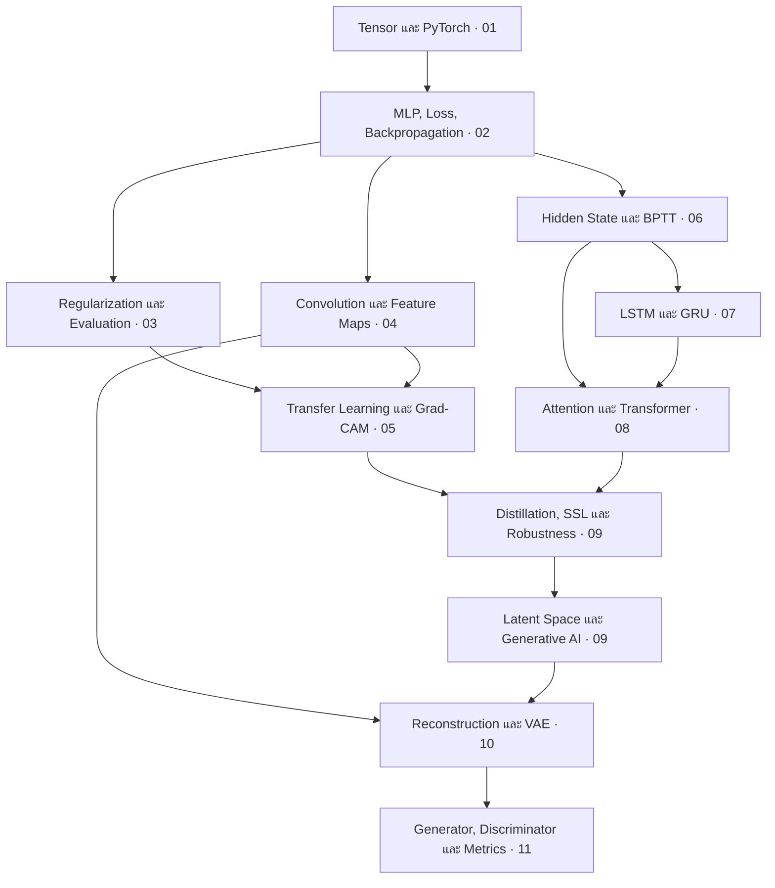

# แผนที่แนวคิด Deep Learning

[Index](../INDEX.md) · [Model Comparison](model-comparison.md)

แผนภาพจัดทำจากลำดับการสอนและความรู้ที่บทหลังนำกลับมาใช้ ลูกศรแสดงความเชื่อมโยงเพื่อทบทวน เช่น Gradient จาก MLP ถูกใช้กับทั้ง BPTT และ Grad-CAM ส่วน CNN ให้ตัวอย่าง Feature Extraction ที่กลับมาใช้ใน Convolutional AE

- [พื้นฐาน MLP และ Evaluation](../lectures/02-mlp-basics.md)
- [ภาพและ Transfer Learning](../lectures/05-cnn-classifier.md)
- [ลำดับและ Attention](../lectures/08-attention-transformer.md)
- [Generative Models](../lectures/10-autoencoder.md)
